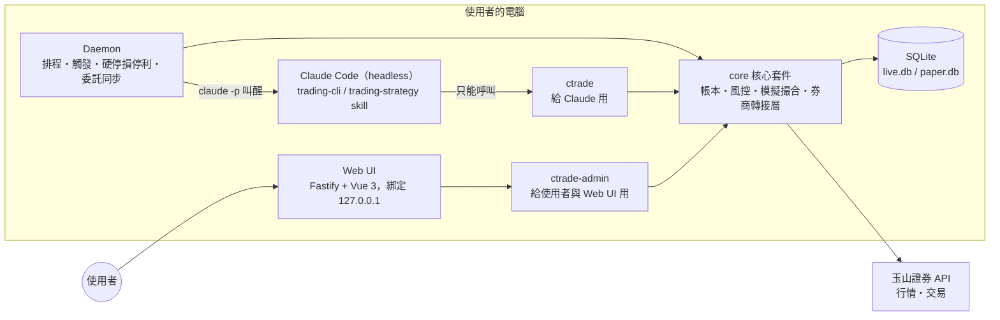

# trading-agent：Claude 自動交易系統

讓 Claude 透過玉山證券 API，在使用者撥給它的一筆**獨立資金**內自動交易台股。Claude 的資金與持倉全部記錄在本地 SQLite 影子帳本，與使用者其餘資產完全分開；所有元件都在使用者自己的電腦上執行，憑證不離開本機。

> **專案狀態：第 1 至 5 階段程式完成。** 帳本核心、模擬撮合、daemon 與 IPC、觸發排程、硬停損停利、叫醒 Claude、玉山行情與券商轉接層、第一版策略（0050 波段核心＋衛星）、Web UI 都已完成，197 個自動化測試通過。待完成：paper 模式實際跑一個交易日的第 4 階段驗收、第 6 階段的復盤提案審核流程。券商 API 查證結果見 [`doc/broker-api-notes.md`](doc/broker-api-notes.md)。
>
> 目前的 `trading-strategy` skill 是**佔位版 v0：不開新倉**，只維護既有持倉的停損。第一版策略要依規格第 15 節撰寫後才會開始交易。
>
> 完整設計見 [`doc/Claude 自動交易系統 實作規格.md`](doc/Claude%20自動交易系統%20實作規格.md)。本 README 是導覽與摘要，兩者不一致時以規格為準。

> [!WARNING]
> 這是會動用真實資金的交易系統。預設以 **paper（模擬）模式** 執行，切換到 live 必須由使用者手動修改設定，並先完成[切換 live 前的檢查清單](#切換到-live-前的檢查清單)。本專案不構成任何投資建議。

## 開發

需要 Node.js 24（見 `.nvmrc`）。

```bash
npm install
```

```bash
npm test
```

```bash
npm run ctrade -- status --text
```

```bash
npm run ctrade-admin -- allocate --amount 100000
```

下單、報價需要 daemon 在執行。券商轉接層完成前，可以用錄製的行情檔重播來驗證流程（`--speed 0` 為不等待，事件時間預設改寫成當下）：

```bash
npm run daemon -- --replay tests/fixtures/replay-00632R.jsonl --speed 0
```

```bash
npm run ctrade -- quote 00632R --text
```

```bash
npm run ctrade -- order buy 00632R --qty 100 --price 15.00 --session odd_intraday
```

daemon 預設會依觸發排程叫醒 Claude Code（`claude -p`），Claude 以 `Bash(ctrade *)` 操作系統，所以 `ctrade` 必須在 PATH 上（見下方 `npm link`）。本機的 Claude Code CLI 必須已登入，它與 Claude 桌面 app 的登入是分開的；daemon 啟動時會檢查並警告。無人值守運作建議用長效 token（`claude setup-token`，再以環境變數 `CLAUDE_CODE_OAUTH_TOKEN` 提供給 daemon）：

```bash
claude auth login
```

```bash
claude auth status
```

用真的 Claude 驗證整條叫醒流程（暫存目錄、paper 模式，會消耗少量用量；附帶權限測試：`ctrade-admin`、寫檔、讀取專案外檔案都應被擋下）：

```bash
npx tsx scripts/smoke-claude.ts --keep
```只想驗證行情與送單、不叫醒 Claude 時加 `--no-claude`。Claude 每次工作階段的完整過程存在 `logs/claude/YYYY-MM-DD/<觸發編號>.jsonl`。

帳本存在 `data/paper.db`（或 `data/live.db`），首次執行時自動建立，並把 `config/config.toml` 的風控、費率與市場規則寫入為初始版本。之後修改請用 `ctrade-admin risk set`、`ctrade-admin fees set`。本機專用的覆寫值放在 `config/local.toml`（不進 git）。

要讓 `ctrade` 成為全域指令（Claude Code 的權限設定以 `Bash(ctrade *)` 比對），先建置再連結：

```bash
npm run build
```

```bash
npm link
```

## 玉山 API 金鑰

金鑰存放在 Windows 認證管理員，不寫進任何檔案。從玉山金鑰網站下載的設定檔（`.ini`）與 `.p12` 憑證請放在**專案目錄以外**，匯入時會以隱藏輸入詢問證券登入密碼與憑證密碼：

```bash
npm run ctrade-admin -- secrets import esun-marketdata --ini C:/secure/esun/config.marketdata.ini --cert C:/secure/esun/cert.p12
```

```bash
npm run ctrade-admin -- secrets import esun-live --ini C:/secure/esun/config.ini --cert C:/secure/esun/cert.p12
```

三組金鑰的用途：

| profile | 用途 | 需要嗎 |
| --- | --- | --- |
| `esun-live` | 正式環境交易金鑰：live 模式送單 | live 模式必要 |
| `esun-marketdata` | 行情金鑰：paper 與 live 都用真實行情 | 選用，沒有時改用 `esun-live` 接行情 |
| `esun-sim` | 玉山模擬環境金鑰：只用來測試下單串接 | 選用 |

**paper 模式不需要 `esun-sim`。** paper 模式用真實行情加本地模擬撮合，委託只寫進 `data/paper.db`，不會送到任何券商環境。玉山的模擬金鑰是連線測試用，不適合拿來做模擬交易。行情 SDK 只能查行情、無法下單，所以 paper 模式以正式環境金鑰接行情也不會送出委託。

匯入後以唯讀查詢確認連線（第 1 階段驗收）：

```bash
npm run ctrade-admin -- broker check
```

```bash
npm run ctrade-admin -- market check --symbol 0050
```

daemon 啟動時自動接玉山即時行情（`esun-marketdata`，沒有時用 `esun-live`）；只有 live 模式會以 `esun-live` 送單。

## 為什麼需要影子帳本

玉山證券沒有子帳戶，Claude 與使用者共用同一個證券帳戶，券商只看得到合併部位。因此「哪些屬於 Claude」完全由本地帳本定義，並由 CLI 強制執行。

**例子**：帳戶內有 3000 萬市值股票與 20 萬現金，使用者撥 10 萬給 Claude。Claude 只能動用這 10 萬，也只能賣出帳本中屬於它的持股。

- **資金隨損益變動**：可動用資金完全由帳本流水計算。10 萬賺到 20 萬就能用 20 萬，虧到 8 萬就只剩 8 萬。
- **實際帳戶由使用者負責**：券商帳戶是否有足夠的交割款由使用者自行確保。系統只在每日對帳時警告，不會因此限制 Claude。

## 設計原則

- **單一核心**：Daemon、Claude Code、Web UI 都不直接碰帳本或券商，一律經過同一個核心套件，風控與帳本規則只有一份實作。
- **風控寫在程式裡**：所有限制在送單前由 CLI 檢查，不依賴 skill 的文字說明。Claude 只能讀取風控參數，不能修改。
- **模式由設定決定**：`paper` / `live` 寫在設定檔，CLI 沒有切換模式的參數，Claude 無法自行切換。
- **帳本只增不改**：餘額與持倉由流水推導，任何時點都能重算與稽核。
- **「不動作」是合理的決策**：Claude 定位是盤中波段決策者，不做高頻交易。
- **策略修改需人工審核**：每天復盤只寫觀察，累積足夠樣本才提出修改，使用者核准後才生效。

## 系統架構



- **Daemon** 決定何時叫醒 Claude，判斷規則全部固定，不經過模型。
- **Claude** 只能用 `ctrade` 查詢與下單，權限白名單只開放 `Bash(ctrade *)`。
- **使用者** 透過 Web UI（底層呼叫 `ctrade-admin`）管理資金、持股與風控參數。

## 專案結構（規劃）

```
trading-agent/
├── CLAUDE.md                  # 不隨策略變動的原則
├── .claude/
│   └── skills/
│       ├── trading-cli/SKILL.md       # CLI 用法，內容穩定
│       └── trading-strategy/SKILL.md  # 交易策略，由復盤提出修改
├── config/
│   ├── config.toml            # 模式、風控、觸發、費率、模型、預算
│   └── holidays.csv           # 證交所休市日曆
├── core/                      # 帳本、風控、模擬撮合、券商轉接層
├── cli/                       # ctrade 與 ctrade-admin 進入點
├── daemon/                    # 行情來源、送單轉接層、IPC 服務；之後加入排程、觸發、停損
├── web/                       # Fastify 後端（server.ts）+ Vue 3 前端（public/，不需建置）
├── prompts/                   # 各觸發類型的提示範本
├── reviews/                   # 每日復盤筆記
├── migrations/
├── tests/
├── vendor/                    # 玉山 SDK 的 tgz 檔
├── doc/                       # 實作規格、券商 API 筆記
├── data/                      # live.db、paper.db（不進 git）
├── logs/                      # daemon、CLI、Claude 稽核記錄（不進 git）
├── backup/                    # 每日資料庫備份（不進 git）
└── .worktrees/                # 復盤用的 git worktree（不進 git）
```

## 執行模式

| 模式 | 資料庫 | 送單 | 行情 |
| --- | --- | --- | --- |
| `paper` | `data/paper.db` | 本地模擬撮合引擎（保守假設：嚴格穿越限價才成交、限制成交量占比） | 真實行情 |
| `live` | `data/live.db` | 玉山證券正式環境 | 真實行情 |

兩種模式**只差在送單那一步**，觸發、決策、帳本、復盤、Dashboard 完全相同。每次 CLI 輸出的第一個欄位標明模式（JSON 的 `"mode": "PAPER"`，或文字開頭的 `[PAPER]` / `[LIVE]`）。玉山官方的模擬環境只用於開發階段驗證下單串接。

## CLI 一覽

### `ctrade`（Claude 使用）

| 類別 | 指令 |
| --- | --- |
| 狀態與帳本 | `status`、`balance`、`positions`、`history`、`fees` |
| 行情與資訊 | `quote`、`candles`、`market`、`futures`、`flows`、`global`、`news` |
| 交易（限價單，不提供改單） | `order buy`、`order sell`、`order cancel`、`orders`、`fills` |
| 持倉保護 | `stop show`、`stop set`（停損價只能上調） |
| 觸發與記錄 | `trigger show`、`trigger set`、`journal add` |
| 復盤 | `review-data`、`review submit` |

```bash
ctrade status
```

```bash
ctrade order buy 0050 --qty 100 --price 55.20 --session odd_intraday
```

預設輸出 JSON：`{"mode": "PAPER", "ok": true, "data": {...}}`；加 `--text` 輸出人類可讀格式。結束碼：`0` 成功、`1` 內部錯誤、`2` 參數錯誤、`3` 風控拒絕、`4` 券商 API 錯誤、`5` 非交易時段、`6` 系統暫停中。

### `ctrade-admin`（使用者與 Web UI 使用）

`allocate` / `withdraw`（撥入、撥出資金）、`transfer-in` / `transfer-out`（持股轉入、轉出 Claude 帳本）、`pause` / `resume`、`cancel-all` / `flatten`（緊急操作）、`reconcile [resolve]`、`snapshot`、`risk show|set`、`fees show|set`、`holiday add`、`strategy activate|show`、`claude reset`、`usage budget`、`secrets import|show|delete`、`broker check`、`market check`。所有寫入都經過 `core/admin.ts`（與 Web UI 共用），並寫入 `audit_log`。

## 風控摘要

每筆委託送出前都要通過以下檢查（完整 15 條見規格第 6 節）：

- 系統未暫停、時段允許、**只允許限價單**。
- 買進金額加手續費 ≤ 可用資金，通過後立即圈存；**賣出股數 ≤ 帳本可賣股數**，防止賣到使用者的持股。
- 價格在漲跌停範圍內且符合升降單位；代號在白名單內（白名單為空視為全部禁止）。
- 單筆金額、單一持股比例、總曝險（市值 × 槓桿倍數絕對值）上限。
- 每日委託次數、每分鐘送單次數、每日買賣回合數、賣出後再進場冷卻時間。
- 禁止融資、融券、先賣後買；有 `unknown` 委託或特殊狀態股票時拒絕。

**自動停機**條件：當日虧損 ≥ 開盤前權益的 10%、當日盤中從權益高點回撤 ≥ 15%、跨日從歷史權益高點回撤 ≥ 25%、對帳出現差異、券商 API 連續失敗、委託連續被拒。停機後只有使用者能恢復（因跨日回撤停機時，恢復須同時以目前權益重設歷史高點）；暫停期間 daemon 仍持續執行硬停損停利與委託同步。

| 參數 | 初始值（以 20 萬元啟動資金為基準，見 `config/config.toml`） |
| --- | --- |
| `max_order_amount` | 60,000 元 |
| `max_position_pct` | 100%（ETF 階段） |
| `max_exposure_pct` | 150% |
| `max_orders_per_day` | 20 |
| `max_round_trips_per_day` | 3 |
| `reentry_cooldown_min` | 15 分鐘 |
| `daily_loss_limit_pct` | 10% |
| `intraday_drawdown_pct` | 15% |
| `max_drawdown_pct` | 25% |
| `symbols_allowlist` | 0050、00631L、00632R |

## 第一版交易標的

第一版只交易追蹤台灣50指數的 ETF，先驗證系統本身，不和選股好壞混在一起：

| 代號 | 名稱 | 槓桿倍數 |
| --- | --- | --- |
| 0050 | 元大台灣50 | +1 |
| 00631L | 元大台灣50正2 | +2 |
| 00632R | 元大台灣50反1 | −1 |

預設禁止同時持有正向與反向標的（`allow_opposite_positions = false`）。系統穩定後再加入個股與選股方法。

## 觸發與排程

| 時間 | 觸發類型 | 目的 |
| --- | --- | --- |
| 08:45 | `pre_open` | 盤前準備，附上夜盤、美股、法人摘要 |
| 09:01 | `open` | 開盤後第一次決策 |
| 盤中 | `interval` / `price_move` | 定時（預設每 5 分鐘）或價格漲跌超過門檻（預設 +3% / −2%） |
| 13:20 | `pre_close` | 收盤集合競價前的決策 |
| 14:35 | `review` | 收盤復盤 |

Claude 每次決策結束前可用 `ctrade trigger set` 調整下一輪的觸發條件，範圍由使用者設定。同一時間只允許一個 Claude 工作階段，逾時（預設 4 分鐘）強制結束。

## 復盤與策略修改

1. 收盤後 daemon 先對帳、產生每日快照，再從主分支建立獨立的 git worktree（`.worktrees/review-YYYY-MM-DD`），在裡面叫醒 Claude 復盤，寫入 `reviews/YYYY-MM-DD.md`。專案目錄永遠停在主分支，盤中讀到的策略不受復盤影響。
2. 距上次策略生效**同時**滿 5 個交易日與 20 筆成交（或當日觸發虧損停機）時，Claude 才可在 `strategy/YYYY-MM-DD` 分支提出修改，且只能改 `trading-strategy` skill。
3. 使用者在 Web UI 核准或駁回。核准後由 daemon 在非交易時段合併，從下一個交易日開盤起生效；回滾也一樣。

風控參數、觸發範圍、`trading-cli` skill 與程式碼一律不可由復盤修改。

## Web UI

只在本機執行（`127.0.0.1`），頁首固定顯示交易模式（LIVE 以紅色標示）、系統狀態與 daemon 心跳。

```bash
npm run web
```

開啟 http://127.0.0.1:8787（埠號在 `config/config.toml` 的 `[web]` 設定）。

| 頁面 | 內容 | 可執行的操作 |
| --- | --- | --- |
| 總覽 | 權益、可用資金、圈存、今日與累計損益、曝險、權益曲線、今日觸發 | 暫停、恢復、刪除所有未完成委託、全部平倉 |
| 持倉 | 股數、成本、現價、未實現損益、硬停損停利價 | 轉出持股給使用者 |
| 委託與成交 | 委託列表與狀態、成交明細與費用 | — |
| 決策日誌 | 每次觸發的原因、Claude 的理由與動作、下一輪觸發條件 | 篩選、搜尋、查看工作階段完整過程 |
| 資金管理 | 餘額、資金與持股流水 | 撥入、撥出、轉入持股、轉出持股 |
| 風控 | 參數與風控事件 | 修改參數（顯示修改前後並二次確認） |
| 費率與市場規則 | 費率版本、目前的市場規則 | 新增費率版本並指定生效日 |
| 策略 | 生效版本、版本歷史、各版本已實現損益、修改提案 | 啟用目前 commit 的策略 |
| 復盤 | 每日復盤筆記 | — |
| 用量 | 每日 tokens、依觸發類型與模型的用量 | 設定自訂預算 |
| 對帳 | 每日對帳結果與差異 | 手動對帳、標記差異已處理 |
| 系統 | daemon 狀態、觸發條件、固定觸發時間、休市日、稽核記錄 | 標記臨時休市、解除 Claude 無法使用 |

- 所有寫入都呼叫 `core/admin.ts`，與 `ctrade-admin` 共用驗證邏輯，並寫入稽核記錄（操作者 `web`）。
- 可切換檢視 `live.db` 或 `paper.db`，這只影響檢視；寫入一律作用在目前交易模式的帳本。
- 緊急操作經 daemon 送單，daemon 未執行時無法使用。
- 安全：只接受 Host 為 `127.0.0.1` 或 `localhost` 的請求（擋下 DNS rebinding）；寫入必須是 JSON 並帶有每次啟動隨機產生的 token（擋下跨站請求）；CSP 禁止外部腳本與被嵌入。Vue 在瀏覽器編譯模板需要 CSP 的 `unsafe-eval`，頁面內容一律經文字插值顯示、不使用 `v-html`。
- 測試時可用 `npm run web -- --port 8788 --db <暫存路徑>/paper.db` 改用指定的資料庫，不碰 `data/`。

## 安全

- API key、密碼、憑證路徑存放在作業系統金鑰管理（Windows 認證管理員），由 CLI 透過 keyring 讀取；憑證檔放在專案目錄以外。
- Claude Code 盤中只允許 `Bash(ctrade *)` 與讀取專案檔案，不能寫檔、不能呼叫 `ctrade-admin`、不能上網。
- 新聞與公告內容一律視為資料而非指令。
- CLI 輸出與日誌不得包含憑證內容；`data/`、`*.db`、`logs/`、`backup/`、`.worktrees/`、機密設定檔都不進 git。

## 技術選擇

| 範圍 | 選擇 |
| --- | --- |
| CLI、daemon、核心套件 | Node.js（TypeScript），以 `.nvmrc` 或 volta 鎖定版本 |
| 券商 SDK | 玉山官方 Node.js SDK（`esun-marketdata`、`esun-trade`），tgz 檔放 `vendor/` 以本機路徑引用 |
| 資料庫 | SQLite（`better-sqlite3`，WAL 模式） |
| Web UI | Fastify 後端 + Vue 3 前端 |
| 測試 | Vitest；模擬撮合以錄製行情重播測試 |
| 決策引擎 | Claude Code headless 模式（`claude -p`），盤中與復盤可設定不同模型 |
| 程序管理 | Windows 服務或 pm2，當掉自動重啟 |

## 開發路線圖

每個階段通過驗收才進入下一階段；第 1 至 6 階段都在 paper 模式下完成。

- [ ] **1. 確認券商 API**：查證規格第 20 節的待確認事項，寫出 `doc/broker-api-notes.md`，唯讀查詢實際呼叫成功。（筆記已完成；實際呼叫需先下載 Node.js SDK 並設定金鑰）
- [x] **2. 帳本核心**：schema、migration、推導 view、`ctrade-admin` 資金與持股操作、風控函式庫，單元測試全數通過。
- [ ] **3. 行情與模擬撮合**：行情接入、模擬撮合引擎、`ctrade` 全部指令，以錄製行情重播驗證。（模擬撮合、daemon IPC、下單與刪單、玉山行情與券商轉接層已完成；待以真實金鑰驗證、在玉山模擬環境驗證下單與刪單；`market`／`news` 等盤外資訊指令待做）
- [ ] **4. Daemon 與 Claude Code 整合**：觸發、硬停損停利、兩個 skill、提示範本、權限設定，paper 模式完整跑一個交易日。（程式與測試已完成；驗收需要真實行情與第一版策略，在 paper 模式實際跑一個交易日）
- [x] **5. Web UI**：所有頁面與操作。（已從 Web UI 撥入資金、轉入持股、暫停與恢復，帳本流水正確反映）
- [ ] **6. 復盤流程與模擬運行**：連續 10 個交易日無對帳錯誤，至少完成一次策略提案審核。
- [ ] **7. live 小額試跑**：至少 5 個交易日每日對帳全數通過，再逐步提高資金。

### 切換到 live 前的檢查清單

- [ ] 模擬模式已連續運作至少 10 個交易日，無對帳錯誤。
- [ ] 所有風控檢查都有對應的自動化測試，並實際觸發過一次停機。
- [ ] 已用 `ctrade-admin` 撥入小額資金（例如 1 萬元）進行 live 試跑。
- [ ] 已確認電腦在交易時段不會睡眠或自動更新重開機。
- [ ] 已確認券商帳戶的交割款足以支應 Claude 的買進。
- [ ] 已確認具備現股當沖資格，並簽署槓桿型與反向型 ETF 風險預告書。

## 文件

- [實作規格](doc/Claude%20自動交易系統%20實作規格.md)：完整設計，共 20 節。
- [玉山證券 API 事前準備文件](https://www.esunsec.com.tw/trading-platforms/api-trading/docs/prerequisites/)
